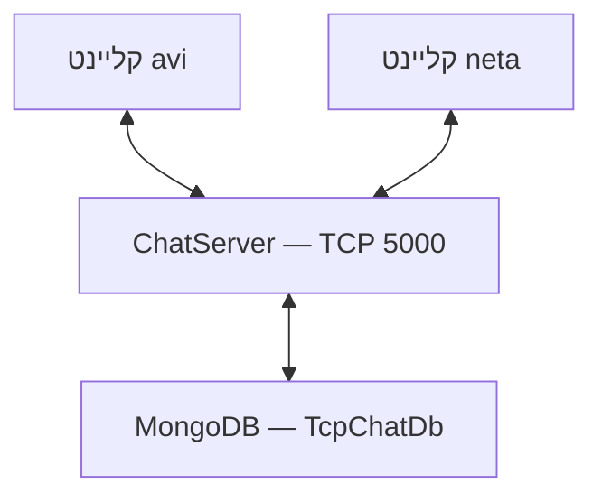
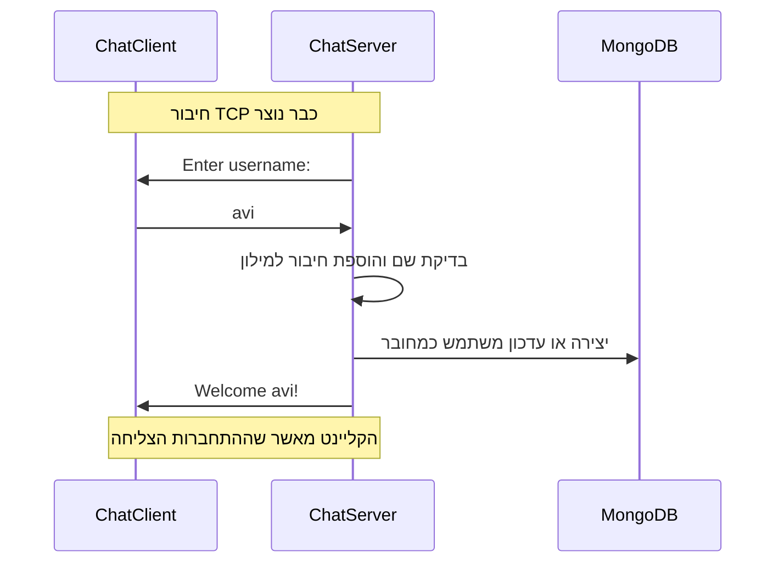
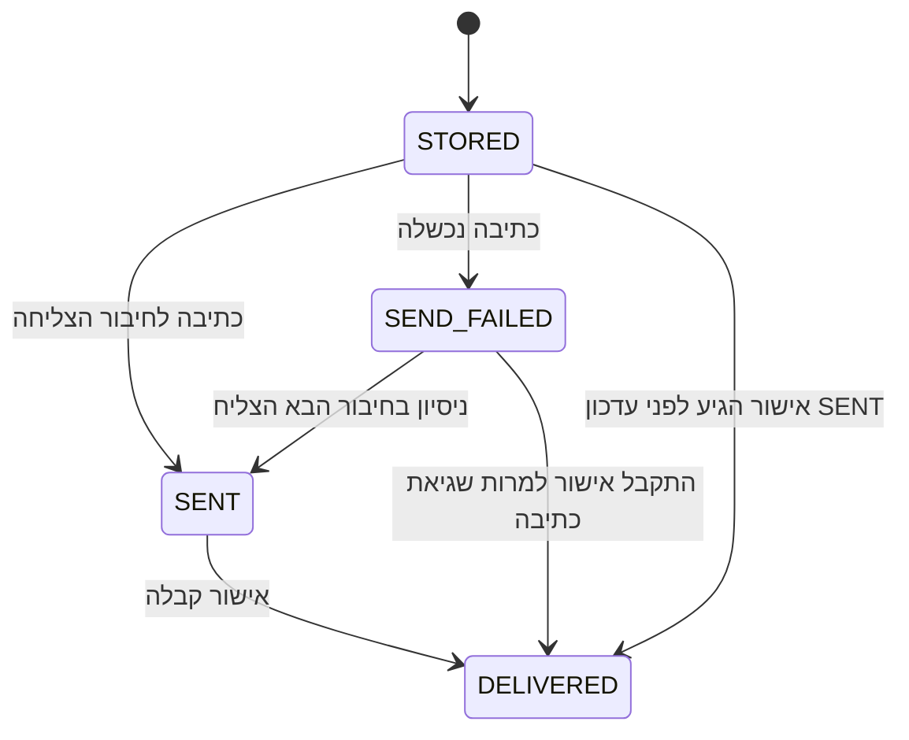

# TCP Chat — צ׳אט ב־C# עם MongoDB

מערכת צ׳אט בקונסול שבה משתמשים מתחברים לשרת מרכזי באמצעות TCP, שולחים הודעות פרטיות ושומרים משתמשים והודעות ב־MongoDB.

המסמך מסביר את הקוד מההתחלה: מה קורה כשמריצים את התוכנית, כיצד נוצר החיבור, כיצד הודעה עוברת ומה קורה כשהמקבל מנותק.

> המסמך מבוסס על הקוד ששיתפת ועל השינויים האחרונים בשיחה, כולל אישורי קבלה ומסירת הודעות בחיבור מחדש. אם שינוי עדיין לא הועתק לפרויקט, ההתנהגות המתוארת עבורו עדיין לא תהיה זמינה.

## תוכן עניינים

1. [התמונה הכללית](#התמונה-הכללית)
2. [מבנה הפרויקט](#מבנה-הפרויקט)
3. [איך מפעילים](#איך-מפעילים)
4. [מה קורה בהפעלת השרת](#מה-קורה-בהפעלת-השרת)
5. [איך נוצר חיבור](#איך-נוצר-חיבור)
6. [מסלול של הודעה](#מסלול-של-הודעה)
7. [קבלת הודעות ושליחתן במקביל](#קבלת-הודעות-ושליחתן-במקביל)
8. [MongoDB וסטטוסים](#mongodb-וסטטוסים)
9. [הודעות למשתמש מנותק](#הודעות-למשתמש-מנותק)
10. [מושגי הקוד](#מושגי-הקוד)
11. [בדיקה ותקלות](#בדיקה-ותקלות)
12. [סדר מומלץ לקריאת הקוד](#סדר-מומלץ-לקריאת-הקוד)

## התמונה הכללית

בפתרון יש שתי תוכניות נפרדות:

| תוכנית | תפקיד |
|---|---|
| `ChatServer` | מאזינה לחיבורים, מנהלת משתמשים, שומרת ומעבירה הודעות |
| `ChatClient` | קוראת קלט מהמשתמש, שולחת לשרת ומציגה הודעות שהתקבלו |

מריצים שרת אחד, ומופע נפרד של הקליינט לכל משתמש. הלקוחות אינם מתחברים ישירות זה לזה. גם הודעה מאבי לנטע עוברת דרך השרת.

MongoDB נגיש לשרת. הקליינט אינו קורא או כותב אליו ישירות.



## מבנה הפרויקט

| קובץ | תפקיד |
|---|---|
| `TcpChat.sln` | מרכז את שני הפרויקטים בפתרון אחד |
| `docker-compose.yml` | מפעיל את MongoDB ומגדיר שמירת נתונים ב־volume |
| `ChatServer/Program.cs` | טוען הגדרות, יוצר את השירותים ומפעיל את השרת |
| `ChatServer/appsettings.json` | כתובת ופורט השרת והגדרות MongoDB |
| `ChatServer/Networking/TcpServer.cs` | מאזין ומקבל חיבורי TCP חדשים |
| `ChatServer/Networking/ClientHandler.cs` | מטפל לאורך זמן בלקוח מסוים: התחברות, פקודות וניתוק |
| `ChatServer/Services/ClientService.cs` | מחזיק חיבורים פעילים בזיכרון וקורא וכותב אליהם |
| `ChatServer/Services/UserService.cs` | שומר משתמשים ומעדכן סטטוס חיבור במונגו |
| `ChatServer/Services/MessageService.cs` | שומר הודעות, שולח אותן ומטפל באישורי קבלה |
| `ChatServer/Data/MongoDbContext.cs` | מספק גישה לאוספים `users` ו־`messages` |
| `ChatServer/Models/User.cs` | פרטי משתמש שנשמרים במסד |
| `ChatServer/Models/ConnectedClient.cs` | החיבור הפעיל של משתמש, כולל Reader, Writer ונעילת שליחה |
| `ChatServer/Models/ChatMessage.cs` | המסמך שמייצג הודעה במונגו |
| `ChatClient/Program.cs` | מפעיל את הממשק ואת לולאות ההקלדה והקבלה |
| `ChatClient/Networking/TcpChatClient.cs` | יוצר את החיבור ומבצע קריאה, כתיבה וניתוק |
| `ChatClient/Services/ChatService.cs` | מנהל התחברות, פורמט הודעות ופקודות |
| `ChatClient/Models/ChatMessage.cs` | אובייקט הודעה לצורכי שליחה והצגה בקליינט |
| `ChatClient/UI/ConsoleUI.cs` | מציג מידע, הודעות ושגיאות וקורא קלט |

שתי מחלקות `ChatMessage` אינן אותו אובייקט: אחת שייכת לפרויקט השרת ואחת לקליינט. הטקסט שעובר ברשת הוא שמחבר בין שני הצדדים.

## איך מפעילים

### דרישות

- SDK שמסוגל לבנות פרויקט `net8.0`, וזמן ריצה מתאים ל־.NET 8.
- Docker ו־Docker Compose להפעלת MongoDB, או MongoDB מקומי עם הגדרות תואמות.
- כמה חלונות טרמינל: אחד לשרת ואחד לכל קליינט.

### הורדת הקוד

```bash
git clone https://github.com/NetanelPardes/chat.git
cd chat
```

### הפעלת מסד הנתונים

מתיקיית הפתרון, שבה נמצא `docker-compose.yml`:

```bash
docker compose up -d mongodb
```

### בנייה

```bash
dotnet build
```

### הפעלת השרת

מתיקיית הפתרון:

```bash
dotnet run --project ChatServer
```

### הפעלת לקוחות

בחלון נוסף, מתיקיית הפתרון:

```bash
dotnet run --project ChatClient
```

הפעל את אותה פקודה בחלון נוסף כדי לחבר משתמש נוסף. הזן שם אחר בכל חלון.

אם כבר נמצאים בתוך תיקיית פרויקט, למשל `ChatServer`, אפשר להריץ פשוט `dotnet run`.

### שימוש

| קלט | פעולה |
|---|---|
| `neta:Hello` | שליחת הודעה למשתמש neta |
| `/users` | הצגת המשתמשים המחוברים כרגע |
| `/exit` | יציאה מהקליינט וסגירת החיבור |

שם המשתמש צריך להכיל 2–30 תווים, ללא רווח רגיל וללא נקודתיים, לפי הבדיקה הנוכחית בשרת. רשימת `/users` היא רשימת המחוברים בזיכרון, ולא רשימת כל המשתמשים שנשמרו במונגו.

### הגדרות

`ChatServer/appsettings.json`:

```json
{
  "Server": {
    "IpAddress": "127.0.0.1",
    "Port": 5000
  },
  "MongoDB": {
    "ConnectionString": "mongodb://localhost:27017",
    "DatabaseName": "TcpChatDb"
  }
}
```

`127.0.0.1` היא כתובת המחשב המקומי: בהגדרה הזאת גם השרת וגם הקליינטים רצים באותו מחשב. כתובת החיבור בקליינט נמצאת כרגע ב־`Program.cs` שלו.

## מה קורה בהפעלת השרת

`Program.cs` משתמש בפקודות ברמת הקובץ, ולכן לא כתובה בו במפורש פונקציית `Main`. הקומפיילר יוצר את נקודת הכניסה לתוכנית.

### 1. הוראות using

```csharp
using ChatServer.Services;
```

מאפשרת להשתמש בשם `UserService` במקום בשם המלא `ChatServer.Services.UserService`. היא לא יוצרת שירות ולא פותחת חיבור.

### 2. טעינת ההגדרות

```csharp
IConfiguration configuration = new ConfigurationBuilder()
    .SetBasePath(AppContext.BaseDirectory)
    .AddJsonFile("appsettings.json", optional: false)
    .Build();
```

| חלק | משמעות |
|---|---|
| `new ConfigurationBuilder()` | יוצר בונה הגדרות |
| `SetBasePath(...)` | קובע את תיקיית הבסיס לחיפוש הקובץ |
| `AppContext.BaseDirectory` | תיקיית ההרצה של היישום |
| `AddJsonFile(...)` | מוסיף את קובץ ההגדרות כמקור |
| `optional: false` | הקובץ נדרש; היעדרו יגרום לכישלון טעינה |
| `Build()` | בונה את מערכת ההגדרות וטוען את המקורות |

ה־csproj מוגדר להעתיק את `appsettings.json` לתיקיית הפלט.

```csharp
configuration["MongoDB:DatabaseName"]
```

קורא את `DatabaseName` מתוך החלק `MongoDB` בקובץ.

### 3. יצירת גישה למונגו

```csharp
MongoDbContext mongoDb = new MongoDbContext(
    connectionString,
    databaseName);
```

בתוך המחלקה נוצרים `MongoClient`, הפניה למסד והפניות לאוספים. קבלת הפניה לאוסף אינה הוכחה שהשרת של מונגו זמין; הפעולות בפועל הן שדורשות תקשורת מוצלחת.

השם `MongoDbContext` הוא שם של מחלקה שלנו. היא אינה `DbContext` של EF Core.

### 4. הכנת המשתמשים

```csharp
UserService userService = new UserService(mongoDb);
await userService.InitializeAsync();
```

נוצר אינדקס ייחודי לשמות משתמשים, והסטטוס של המשתמשים מאופס ל־`IsOnline = false`. זה מתאים לשרת צ׳אט יחיד: החיבורים מההרצה הקודמת כבר אינם קיימים. האיפוס אינו מעדכן את זמן הניתוק האחרון.

### 5. יצירת שירותי הצ׳אט

```csharp
ClientService clientService = new ClientService();
MessageService messageService = new MessageService(clientService, mongoDb);
```

שירות ההודעות מקבל גישה לאותו `ClientService` שמחזיק את החיבורים ולאותו אובייקט גישה למונגו. השירותים אינם מעתיקים את רשימת החיבורים; הם משתמשים באותה הפניה.

### 6. יצירת השרת והפעלתו

```csharp
TcpServer server = new TcpServer(
    ip, port, clientService, messageService, userService);

await server.StartAsync();
```

הבנאי מכין `TcpListener` ו־`ClientHandler`. `StartAsync` מתחיל את ההאזנה בפועל.

## איך נוצר חיבור

### בצד השרת: המתנה לחיבור

```csharp
_server.Start();
TcpClient tcpClient = await _server.AcceptTcpClientAsync();
```

`Start` מתחיל להאזין. `AcceptTcpClientAsync` ממתין לחיבור חדש ומחזיר אובייקט שמייצג אותו כשהוא מתקבל.

### בצד הקליינט: בקשת חיבור

```csharp
_tcpClient = new TcpClient();
await _tcpClient.ConnectAsync(ip, port);
```

יצירת האובייקט לבדה לא מחברת. `ConnectAsync` מבקש ליצור חיבור לכתובת ולפורט של השרת.

כשהחיבור מצליח, לקליינט ולשרת יש כל אחד אובייקט `TcpClient` שמייצג את הצד שלו באותו חיבור.

### הכנת קריאה וכתיבה

```csharp
NetworkStream stream = _tcpClient.GetStream();
```

מחזיר זרם שדרכו קוראים וכותבים בתים ברשת. שני הצדדים עוטפים אותו בכלי טקסט:

| כלי | תפקיד |
|---|---|
| `StreamReader` | מפענח בתים לטקסט |
| `StreamWriter` | מקודד טקסט לבתים וכותב לזרם |
| UTF-8 | הקידוד המשותף לשני הצדדים |
| `AutoFlush = true` | מרוקן את מאגר הכותב אל הזרם לאחר פעולות הכתיבה |
| `leaveOpen: true` | מונע מסגירת העוטף לבדה לסגור את הזרם שמתחתיו |

החיבור מאפשר קריאה וכתיבה בשני הכיוונים. אין צורך בחיבור נוסף כדי לקבל תשובה.

### TCP אינו מפריד הודעות עבורנו

TCP מעביר רצף בתים. בפרויקט קבענו שכל הודעה מסתיימת בסיום שורה:

```csharp
await writer.WriteLineAsync(text);
string? text = await reader.ReadLineAsync();
```

לכן `ReadLineAsync` ממתין עד שיגיע סיום שורה, או עד שהזרם יסתיים. ההמתנה אינה לולאה שרצה שוב ושוב בלי הפסקה.

### זיהוי המשתמש בתוך החיבור

לאחר יצירת חיבור TCP, מתחיל תהליך ההתחברות של היישום:



`ConnectedClient` מחבר בין שם המשתמש, מזהה המשתמש במונגו וחיבור הרשת הפעיל.

השם אינו חלק מובנה מ־TCP. זו מוסכמה שהקוד שלנו מוסיף. כרגע אין אימות סיסמה: הזנת שם של משתמש קיים אינה מוכיחה שזה אותו אדם.

## מסלול של הודעה

נניח ש־avi מקליד:

```text
neta:Hello
```

### 1. Program של הקליינט מפרק את הקלט

```csharp
int separatorIndex = input.IndexOf(':');
```

מיקום הנקודתיים הראשונות הוא `4`. אינדקסים במחרוזת מתחילים ב־0.

```csharp
Receiver = input[..separatorIndex].Trim();
Content = input[(separatorIndex + 1)..];
```

החלק שלפני הנקודתיים הוא המקבל; החלק שאחריהן הוא התוכן. `Trim` מסיר רווחים מהקצוות.

### 2. ChatService מאמת ומכין טקסט

```csharp
string text = $"{message.Receiver}:{message.Content}";
await _tcpClient.SendAsync(text);
```

שם השולח אינו נשלח כאן. השרת מזהה את השולח מתוך החיבור שממנו קיבל את השורה.

### 3. TcpChatClient כותב לחיבור

נעילת `SemaphoreSlim` מונעת מהקלדה של המשתמש ומאישור קבלה אוטומטי לכתוב ל־`StreamWriter` באותו זמן.

### 4. ClientHandler בשרת מפרש את השורה

הוא מזהה פקודות כמו `/users` ו־`/ack`, או מפרק הודעה למקבל ותוכן ומפעיל:

```csharp
await _messageService.SendPrivateMessageAsync(
    client, receiverName, content);
```

`client` הוא השולח המחובר.

### 5. MessageService שומר ושולח

- מחפש את המקבל באוסף `users` גם אם הוא מנותק.
- דוחה שם שאינו קיים במסד.
- שומר מסמך הודעה עם `STORED`.
- בודק אם קיים כרגע חיבור פעיל של המקבל.
- אם הוא מחובר, שולח אליו את המסמך בפורמט הטקסט המתואר בהמשך.

### 6. הקליינט המקבל מציג ומאשר

הקליינט מפרק את ההודעה, מציג אותה ושולח אישור אוטומטי עם מזהה ההודעה. השרת מעדכן את המסמך ל־`DELIVERED`.

## קבלת הודעות ושליחתן במקביל

ב־`Program.cs` של הקליינט יש שני מסלולים:

| מסלול | על מה הוא ממתין? |
|---|---|
| משימת הקבלה | שורה חדשה מהשרת |
| לולאת ההקלדה | קלט שהמשתמש מסיים ב־Enter |

```csharp
Task receiveTask = Task.Run(async () =>
{
    // Receiving messages
});
```

מפעיל את משימת הקבלה בלי להמתין לסיום שלה, והקוד ממשיך ללולאת הקלט.

`await` בתוך משימת הקבלה משהה את המשך הפעולה עד להגעת הנתונים. הוא אינו עוצר את כל היישום.

בשרת, לכל לקוח יש טיפול משלו:

```csharp
_ = _clientHandler.HandleClientAsync(tcpClient);
```

השרת מתחיל את הטיפול ואז חוזר להמתין לחיבור הבא. `_ =` מתעלם מה־Task המוחזר; הוא אינו יוצר בעצמו תהליכון חדש.

### למה יש נעילת שליחה גם בשרת?

כמה שולחים יכולים לשלוח לאותו מקבל במקביל. נעילת השליחה של `ConnectedClient` מסדרת את פעולות הכתיבה לאותו `StreamWriter`.

הנעילה מונעת כתיבות מקבילות לאותו חיבור; היא אינה מבטיחה כשלעצמה סדר כולל לפי זמני ההודעות במסד.

## MongoDB וסטטוסים

ההיררכיה היא: שרת MongoDB, מסד `TcpChatDb`, אוספים ומסמכים.

| אוסף | מה נשמר בו? |
|---|---|
| `users` | מסמך אחד לכל משתמש |
| `messages` | מסמך אחד לכל הודעה |

לא נוצר אוסף נפרד לכל משתמש או לכל שיחה.

### משתמש

דוגמה בסגנון `mongosh`:

```javascript
{
  _id: ObjectId("6aeb244b9559f6098c4a2f78"),
  Username: "avi",
  IsOnline: true,
  CreatedAtUtc: ISODate("2026-11-04T12:25:47Z")
}
```

`LastSeenAtUtc` עשוי להיעדר עד הניתוק הראשון, כי משתמש חדש נוצר באמצעות Upsert והשדה מתעדכן בניתוק.

### הודעה

```javascript
{
  _id: ObjectId("6aeb33b2e149da39b13a3499"),
  SenderId: ObjectId("6aeb244b9559f6098c4a2f78"),
  ReceiverId: ObjectId("6aeb244f9559f6098c4a2f79"),
  Content: "Hello",
  SentAt: ISODate("2026-11-04T13:31:30Z"),
  Status: "DELIVERED"
}
```

`SenderId` ו־`ReceiverId` מפנים למסמכי המשתמשים. הקוד מנהל את הקשר הזה; אין כאן מפתח זר שמונגו אוכף אוטומטית.

הזמנים נשמרים ב־UTC. הסימון `Z` בפלט מציין UTC, ולכן השעה עשויה להיות שונה משעת המחשב בישראל.

### למה צריך גם מילון חיבורים וגם users?

| מקום | מה הוא מחזיק? | מה קורה בהפעלת השרת מחדש? |
|---|---|---|
| מילון ב־`ClientService` | חיבורים פעילים ואובייקטי קריאה וכתיבה | מתחיל ריק |
| אוסף `users` | זהות משתמש ונתוני פעילות | הנתונים נשמרים במונגו |

רשומת משתמש לא מאפשרת לכתוב אליו ברשת בלי חיבור פעיל. גם `IsOnline` הוא נתון לתיעוד; המילון הוא המקום שבו מחפשים חיבור ממשי לשליחה.

### המצבים

| מצב | משמעות |
|---|---|
| `STORED` | ההודעה נשמרה וממתינה לניסיון שליחה או לאישור |
| `SENT` | פעולת הכתיבה לחיבור הסתיימה ללא חריגה |
| `DELIVERED` | השרת קיבל אישור מהקליינט המקבל ועדכן את המסד |
| `SEND_FAILED` | ניסיון כתיבה לחיבור נכשל; ההודעה עדיין שמורה |



`DELIVERED` אינו אומר שהאדם קרא את ההודעה. הוא אומר שהתוכנה המקבלת אישרה אותה.

### הפרוטוקול שלנו

| כיוון | פורמט | תפקיד |
|---|---|---|
| קליינט אל שרת | `neta:Hello` | בקשת שליחה |
| שרת אל מקבל | `MSG:messageId:avi:Hello` | הודעה עם מזהה ושולח |
| מקבל אל שרת | `/ack messageId` | אישור קבלה אוטומטי |
| קליינט אל שרת | `/users` | בקשת רשימת מחוברים |
| שרת אל קליינט | `Online: avi, neta` | תשובת רשימת מחוברים |

בקליינט:

```csharp
string[] parts = incoming.Split(':', 4);
```

הפיצול מוגבל לארבעה חלקים, ולכן נקודתיים בתוך תוכן ההודעה נשמרות.

### איך מונעים מדריסת DELIVERED?

אישור עלול להגיע מהר: עוד לפני שהשרת הספיק לשמור `SENT`. לכן עדכון תוצאת השליחה כולל תנאי שהסטטוס עדיין אינו `DELIVERED`.

```csharp
.Ne(m => m.Status, "DELIVERED")
```

זהו תנאי בתוך פעולת העדכון במונגו, ולא בדיקה נפרדת בזיכרון. כך עדכון מאוחר אינו מחזיר הודעה מ־`DELIVERED` ל־`SENT`.

אישור הקבלה מסונן גם לפי `ReceiverId` של החיבור, כדי שרק המקבל המתאים יוכל לאשר את ההודעה.

## הודעות למשתמש מנותק

### בזמן השליחה

השרת מחפש את המשתמש במונגו, שומר את ההודעה ואז בודק את החיבור הפעיל. כשהמקבל מנותק, היא נשארת `STORED`, והשולח מקבל הודעת מידע על שמירה למסירה מאוחרת.

כדי לשלוח למשתמש, הוא חייב כבר להיות קיים באוסף `users`, כלומר להתחבר לפחות פעם אחת. אין יצירה אוטומטית של מקבל חדש מתוך הודעה.

### בזמן חיבור מחדש

ב־`ClientHandler`, אחרי שליחת `Welcome` ולפני לולאת הקריאה:

```csharp
await _messageService.SendPendingMessagesAsync(client);
```

הסדר חשוב: הקליינט מצפה לקבל קודם את הודעת ההתחברות.

הפעולה שולפת הודעות שמיועדות למשתמש ושאינן `DELIVERED`, ממיינת לפי `SentAt` ואז לפי המזהה, ושולחת עם המזהים המקוריים. היא אינה מוסיפה מסמך חדש לכל ניסיון.

במימוש הזה אין המתנה לאישור לכל הודעה בתוך פעולת המסירה. לאחר שליחת ההודעות הממתינות, לולאת הקריאה של הלקוח בשרת מטפלת באישורים שהגיעו.

### מגבלות שכדאי להבין

- אין כרגע מנגנון ניסיונות חוזרים תקופתי. הודעה ללא אישור נשלחת שוב בחיבור הבא.
- אם ההודעה הוצגה אבל האישור אבד, היא יכולה להופיע שוב. גם שליחה במקביל להתחברות יכולה ליצור מסירה כפולה. לא נוסף עדיין מנגנון למניעת תצוגה כפולה לפי מזהה.
- הודעות ישנות עם `WRITTEN_TO_CONNECTION` נכללות בשליפה שאינה `DELIVERED`, ולכן עלולות להישלח שוב פעם אחת ולקבל אישור חדש.
- אם עדכון הסטטוס במונגו נכשל, הסטטוס השמור עלול לפגר אחרי מה שקרה ברשת.
- חץ השליחה בקליינט מוצג אחרי הכתיבה לשרת. הוא אינו מציג אישור מסירה או הוכחה שהשרת שמר את ההודעה.
- בזמן טעינת ההודעות הממתינות עשויות להגיע גם הודעות חדשות; המימוש אינו מבטיח סדר זמן מוחלט ביניהן.
- בחיבור הנוכחי, `ConnectedClient` מתפרסם לפני השלמת כל תהליך ההתחברות. שליחה בדיוק בחלון הזמן הזה יכולה להקדים את `Welcome`; סנכרון מוכנות החיבור הוא שיפור עתידי.

## מושגי הקוד

| ביטוי | משמעות בפרויקט |
|---|---|
| `new` | יוצר מופע של מחלקה |
| בנאי | מכין אובייקט חדש ומקבל את התלויות שלו |
| `private readonly` | שדה נגיש בתוך המחלקה, שההפניה שלו נקבעת בהצהרה או בבנאי |
| `Task` | מייצג פעולה שיכולה להסתיים בעתיד |
| `async` | מאפשר שימוש ב־`await` בפונקציה |
| `await` | ממתין לתוצאה בלי לחייב חסימה של התהליכון בזמן ההמתנה האסינכרונית |
| `string?` | מחרוזת שיכולה להיות גם `null` |
| `null` מקריאת שורה | סוף הזרם; בדרך כלל לאחר סגירה מסודרת של הצד השני |
| `while (true)` | לולאה שממשיכה עד יציאה או חריגה |
| `break` | יציאה מהלולאה הקרובה |
| `continue` | מעבר לסיבוב הבא בלולאה |
| `return` | יציאה מהפונקציה |
| `try / catch` | ביצוע פעולה וטיפול בחריגה שנזרקה |
| `finally` | ניקוי בסיום הבלוק גם כשנזרקה חריגה |
| `using` עם משאב | מפעיל Dispose בסיום תחום החיים, גם בעת חריגה |
| `ObjectId` | סוג המזהה המשמש למסמכים בפרויקט |
| `ObjectId.Empty` | ערך ריק המשמש לבדיקה שטרם נקבע מזהה |
| `u => u.Username == username` | ביטוי תנאי המשמש לבניית חיפוש משתמש |
| `IsUpsert = true` | עדכון משתמש קיים או הוספת משתמש אם לא נמצא |
| `ReturnDocument.After` | החזרת המסמך לאחר העדכון |
| `SetOnInsert` | שדה שנקבע רק אם הפעולה מוסיפה מסמך חדש |

`readonly` אינו הופך את האובייקט עצמו לבלתי ניתן לשינוי. למשל, אפשר להוסיף חיבורים למילון שההפניה אליו היא `readonly`.

## בדיקה ותקלות

### בדיקת המשתמשים וההודעות

מתיקיית הפתרון:

```bash
docker compose exec mongodb mongosh
```

בתוך `mongosh`:

```javascript
use TcpChatDb
```

```javascript
db.users.find()
```

```javascript
db.messages.find().sort({ SentAt: -1 })
```

### תרחישי בדיקה ידניים

| בדיקה | תוצאה צפויה |
|---|---|
| חיבור משתמש חדש | נוצר מסמך users עם IsOnline=true |
| חיבור שני לקוחות ושליחת הודעה | ההודעה מוצגת ונשמרת; לאחר אישור הסטטוס DELIVERED |
| שליחת `Time:10:30` כתוכן | הנקודתיים בתוכן נשמרות |
| `/users` | מופיעה רשימת החיבורים הפעילים |
| `/exit` | החיבור מוסר מהזיכרון והמשתמש מסומן כמנותק |
| שליחה למשתמש קיים ומנותק | ההודעה נשמרת כ־STORED |
| חיבור מחדש של אותו משתמש | מתקבלות הודעות שטרם אושרו |
| שליחה לשם שמעולם לא התחבר | מתקבלת User not found |

### MSB3026 — קובץ השרת נעול

אם הבנייה מציגה שהקובץ נעול על ידי `ChatServer`, עצור את השרת הישן באמצעות `Ctrl+C` לפני הבנייה. אפשר לעצור את מזהה התהליך שמופיע בשגיאה באמצעות PowerShell:

```powershell
Stop-Process -Id <PID>
```

החלף את `<PID>` במספר התהליך מהפלט.

### Connection refused

בדוק שהשרת פועל ושהלקוח פונה לכתובת ולפורט הנכונים. הפעלת MongoDB לבדה אינה מפעילה את שרת הצ׳אט.

### MongoDB אינו זמין

```bash
docker compose ps
```

בדוק שהקונטיינר פועל ושפורט `27017` ומחרוזת החיבור תואמים להגדרות. יצירת אינדקס בהפעלת השרת דורשת שמונגו יהיה מוכן לקבל פעולות.

### הודעה מופיעה כטקסט MSG במקום כהודעה רגילה

ודא שגם השרת וגם כל הקליינטים הורצו מחדש לאחר החלפת הפרוטוקול. יש לעדכן את שני הצדדים יחד.

### הפעלה מחדש ושמירת נתונים

volume של Docker שומר את נתוני מונגו בנפרד מהתהליך. אל תשתמש ב־`docker compose down -v` אם ברצונך לשמור את היסטוריית המשתמשים וההודעות: הדגל `-v` מסיר את ה־volumes של הפרויקט.

## סדר מומלץ לקריאת הקוד

אין צורך להתחיל מכל הקבצים יחד. עקוב אחרי פונקציה אחת בכל שלב:

1. **`ChatServer/Program.cs`** — אילו אובייקטים נוצרים, ומה כל אחד מקבל בבנאי?
2. **`TcpServer.StartAsync`** — איפה מתחילה ההאזנה, ואיפה ממתינים לחיבור?
3. **`TcpChatClient.ConnectAsync`** — איך הקליינט מתחבר ומכין Reader ו־Writer?
4. **`ChatService.ConnectAsync` ותחילת `ClientHandler.HandleClientAsync`** — עקוב אחר Enter username, שם המשתמש ו־Welcome בשני הצדדים.
5. **`ClientService`** — איך החיבור נשמר, נשלף, נקרא ונכתב?
6. **לולאות `ChatClient/Program.cs`** — עקוב אחרי קלט אחד והודעה נכנסת אחת.
7. **`MessageService.SendPrivateMessageAsync`** — היכן ההודעה נשמרת לפני השליחה?
8. **`ParseReceivedMessage` ו־`ConfirmDeliveryAsync`** — איך מזהה ההודעה חוזר לשרת באישור?
9. **`SendPendingMessagesAsync`** — איך משתמש שחזר מקבל את ההודעות השמורות?
10. **בלוקי `finally`** — מה מתנקה ומי מעדכן סטטוס כשהלקוח מתנתק?

בכל קריאה שאל: מי קרא לפונקציה, מה הפרמטרים שקיבלה, מה היא משנה, ולמי היא מעבירה את העבודה הבאה.
